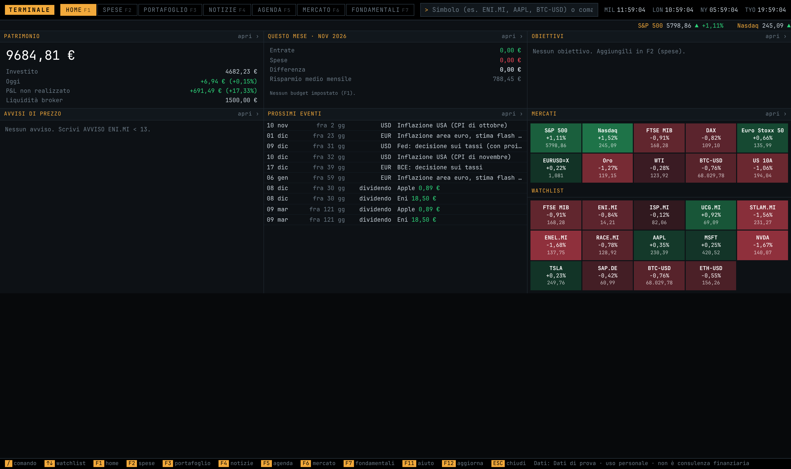
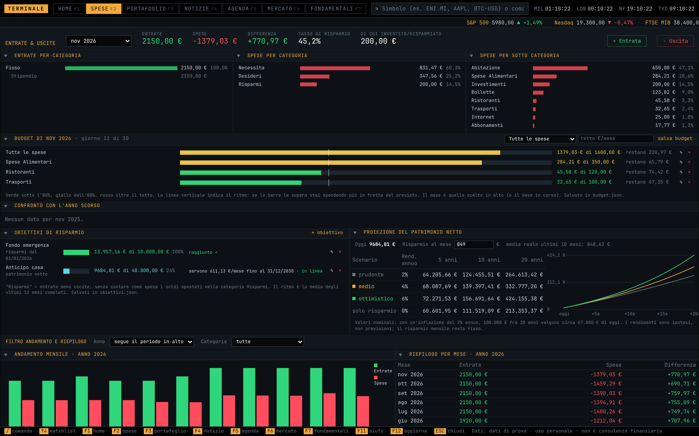
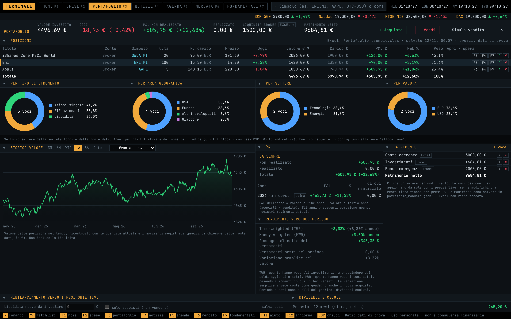
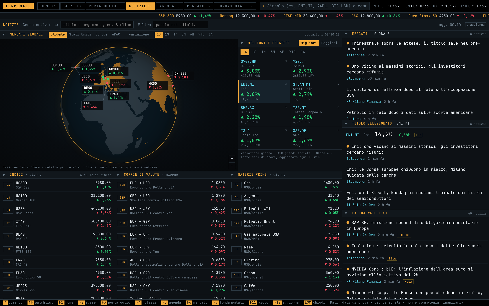
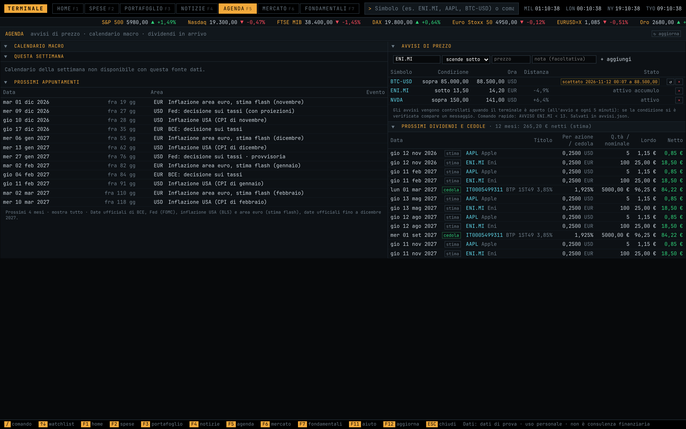
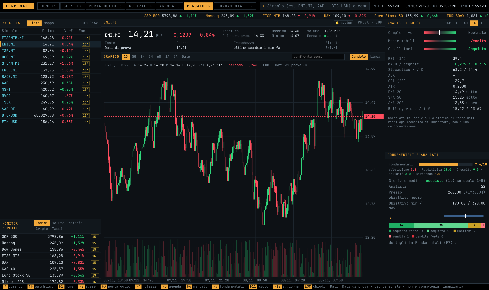
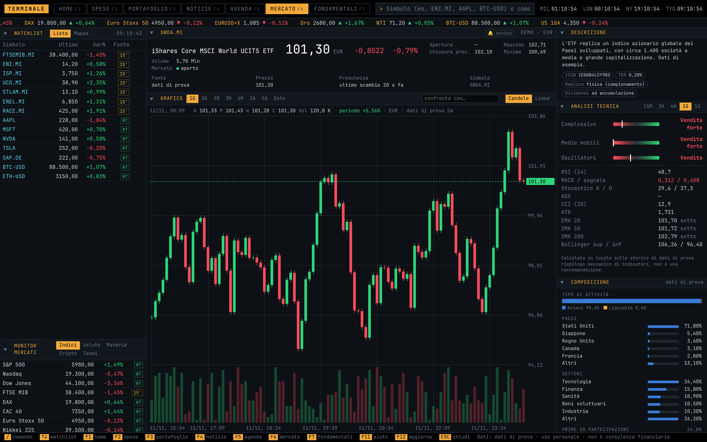
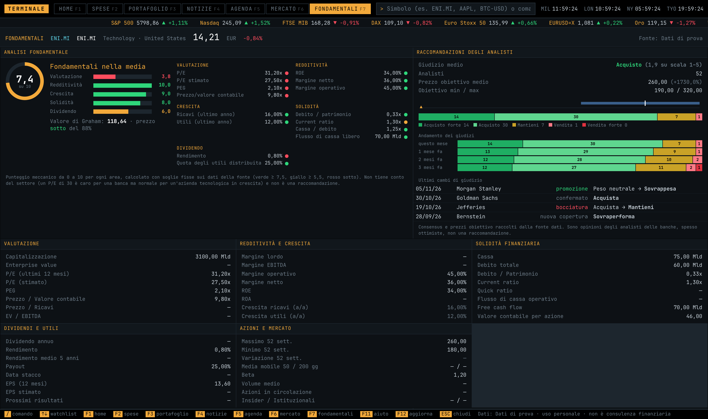

# Financial Terminal

A professional-style personal financial terminal that runs locally in the browser. One dark, dense screen brings together quotes, charts, technical and fundamental analysis, world news on an interactive globe, a securities portfolio and personal budgeting.

> 🔒 **The source code lives in a private repository.** This page is a showcase of the project. If you'd like to see the code, get in touch and I'll give you access.

_All screenshots use made-up test data: no personal data and no real prices. The interface is in Italian._

## At a glance

- **Zero dependencies**: a Python 3 server built only on the standard library, and the interface in a single HTML file with plain JavaScript. Charts, the globe and the donut charts are all hand-drawn on `<canvas>`, with no external libraries.
- **Over 5,000 lines** of backend (Python) and frontend (HTML/CSS/JS), seven pages and more than 40 panels.
- **Privacy first**: the server listens only on `127.0.0.1`. Portfolio, expenses and API keys stay in local files, and the user's Excel files are opened read-only.
- **Pluggable data source**: the terminal isn't tied to any provider. A small connector (`fonte.py`) plugs in any market data API; features the API doesn't offer are simply shown as unavailable.
- **Works offline**: every response is saved to disk and reused without a connection, with a banner showing how old the data is.

## Pages

| Key | Page | What it does |
|---|---|---|
| **F1** | Home | Net worth with a chart over time, current month with budgets, savings goals, price alerts, upcoming events (macro, dividends, coupons), heatmap of markets and watchlist |
| **F2** | Income & Expenses | Income and expenses by category and subcategory, savings rate, monthly budgets with a pace indicator, year-over-year comparison, savings goals, three-scenario net-worth projection, filterable monthly trend and summary, editable transactions |
| **F3** | Portfolio | Positions repriced in real time, realized and unrealized P&L (also by year), allocation by instrument, region, sector and currency, value history compared with an index, TWR and MWR returns, rebalancing, dividends and coupons, sale tax simulation, tax-loss tracker |
| **F4** | News | Interactive globe with the indices, regions (Global, United States, Europe, Asia-Pacific), performance by period, top gainers and losers, regional indices, currencies and commodities, three-level news feed |
| **F5** | Agenda | Price alerts with notifications, macro calendar (ECB, Fed, inflation), upcoming dividends and coupons with gross and net amounts |
| **F6** | Market | Watchlist (list or heatmap), candlestick or line chart, two-ticker comparison, technical analysis, ETF description and holdings, fundamentals at a glance, market monitor |
| **F7** | Fundamentals | 0–10 fundamental score across five areas, Graham value, analyst consensus and rating history, financial statements, dividends by year, price history with CSV export |

### F1 · Home

- **Net worth** with a 3M / 6M / YTD / 1Y / 5Y chart: the past is reconstructed from portfolio transactions, and from today on the real value is saved every day.
- Current month: income, expenses, difference, average savings and budget bars.
- Progress on savings goals, with the monthly amount needed to reach each one on time.
- Price alerts, upcoming macro events, dividends and coupons, and a heatmap of indices, currencies, commodities and the watchlist.

### F2 · Income & Expenses

- Summary for the chosen period (month, year or custom dates): income, expenses, difference, savings rate and amount invested.
- Expenses by category and subcategory with proportional bars.
- **Monthly budgets** by category, subcategory or in total, color-coded by threshold, with a line showing the expected spending pace for that day of the month.
- Comparison with the same period of the previous year.
- **Savings goals** (based on savings, a single item or net worth) with a deadline.
- **Net-worth projection** at 5, 10 and 20 years under three return scenarios, with a note on inflation.
- Monthly trend and month-by-month summary filterable by year and category; editable transaction list and manual entry of income and expenses.

### F3 · Portfolio

- Positions read from the broker's Excel export and **repriced in real time**, with P&L in euros and percent, weight, and shortcuts to the chart, news and fundamentals.
- Cash and net-worth items editable right from the page, without touching the Excel file.
- **Allocation** in four donut charts: instrument type, region, sector and currency.
- **Value history** over several periods or custom dates, comparable with an index.
- **P&L** since inception and by year, realized and unrealized.
- **True return for the period**: time-weighted (TWR) and money-weighted (MWR/XIRR), computed from scratch.
- Buys and sells that can be recorded and undone, plus a **sale simulation** with estimated taxes (Italian 26% and 12.5% rates).
- **Rebalancing** toward target weights, optionally with buys only.
- Dividends and coupons received and expected, bonds with a coupon calendar, and a **tax-loss tracker** with the expiry of each capital loss.

### F4 · News

- **Interactive globe** drawn on canvas: drag to rotate, zoom, and it works offline. Index labels show the change and open the chart and news.
- Four regions (Global, United States, Europe, Asia-Pacific), each with its own indices, currency pairs and commodities.
- **Performance by period** (1D, 1W, 1M, 3M, 6M, YTD, 1Y) for every panel.
- **Gainers and losers**: the large-cap stocks of the region that rose or fell the most in the chosen period.
- News on three levels: the region's markets, the selected ticker, and the watchlist tickers, with search and filter.

### F5 · Agenda

- **Price alerts** (above or below a threshold) checked in the background, with an on-screen notification and the distance from the threshold.
- **Macro calendar**: ECB and Fed meetings, US and euro-area inflation, with a countdown.
- **Upcoming dividends and coupons** for the next 12 months, with estimated gross and net amounts.

### F6 · Market

- Watchlist as a list or **heatmap**, with the data delay (real time or 15 minutes) for each ticker.
- Header with price, change, high, low, volume and how fresh the last trade is.
- **Chart**: candlesticks or line from 1 day to 5 years or custom dates, with **hover tooltips**, volume, and percentage comparison against a second ticker.
- **Technical analysis** on several timeframes (15m, 1h, 4h, 1d, 1w): overall rating, moving averages and oscillators, RSI, MACD, stochastic, ADX, CCI, ATR, Bollinger Bands.
- Ticker **description** and, for ETFs, funds and indices, **holdings breakdown**: asset type, countries, sectors and top 10 holdings, with ISIN, costs and replication method.
- Fundamentals and analyst rating at a glance for stocks.
- Monitor of indices, currencies, commodities, crypto and rates, plus a scrolling ticker tape at the top.

### F7 · Fundamentals

- **0–10 fundamental score** across five areas (valuation, profitability, growth, financial strength, dividend), with a traffic light for each metric and the **Graham value**.
- **Analyst recommendations**: average rating, low, mean and high price targets, how ratings have moved over recent months, and the latest rating changes.
- Valuation, profitability and growth, financial strength, dividends and earnings, market data, company profile.
- Annual financial statements, dividends by year and price history with CSV export.

## Interface

- **Keyboard-driven**: function keys for the pages and a command line (`/`) to open tickers, manage the watchlist, change the chart range, record trades and create alerts (e.g. `AVVISO ENI.MI < 13`, `VS AAPL`).
- **Collapsible sections**: every panel folds away with an arrow, and the choice is remembered.
- Chart tooltips, clocks for the main exchanges, and a warning when the running server is older than the page.
- Automatic shutdown after a configurable period of inactivity.

## Technical highlights

- **Backend**: multithreaded `http.server` with a JSON API, in-memory cache with expiry, persistent on-disk cache for offline use, rate limiting toward the data provider, parallel work on a thread pool.
- **Data**: reads Excel (`.xlsx`) files with the standard-library XML parser; atomic JSON writes (temp file plus `fsync`) with automatic recovery of corrupted files.
- **Finance**: TWR and XIRR computed from scratch, historical reconstruction of the portfolio and net worth from transactions, multi-period performance, bond coupon schedules, Italian taxation (26% and 12.5%) and capital-loss expiry.
- **Frontend**: candlestick, area, bar and donut charts and an orthographic globe with rotation and zoom, all on canvas; responsive grid layout; high-contrast dark theme.
- **Analysis**: technical indicators computed locally, and a fundamental score based on multiples, profitability, growth, financial strength and dividend.

## Stack

Python 3 · HTML · CSS · JavaScript (vanilla) · Canvas API

---

Personal project. Not financial advice, and not affiliated with any data provider.

🇮🇹 Riassunto in italiano

Un terminale finanziario personale in stile professionale che gira in locale, nel browser. Server in Python 3 con la sola libreria standard e interfaccia in un unico file HTML con JavaScript puro, grafici e mappamondo disegnati a mano su canvas (oltre 5.000 righe). Sette pagine guidate da tastiera: Home con il grafico del patrimonio; entrate e uscite con budget, obiettivi di risparmio e proiezione del patrimonio; portafoglio (prezzi in tempo reale, allocazione, TWR/XIRR, confronto con un indice, ribilanciamento, dividendi, cedole, tassazione italiana); notizie con mappamondo interattivo, mercati per regione, variazioni per periodo e migliori/peggiori; agenda con avvisi di prezzo e calendario macro; mercato con grafici a candele, tooltip, analisi tecnica e composizione degli ETF; analisi fondamentale con punteggio 0–10, valore di Graham e consenso degli analisti. La fonte dati si collega con un piccolo connettore e tutto resta sul PC dell'utente.

**Il codice sorgente è privato: scrivimi per avere accesso.**

